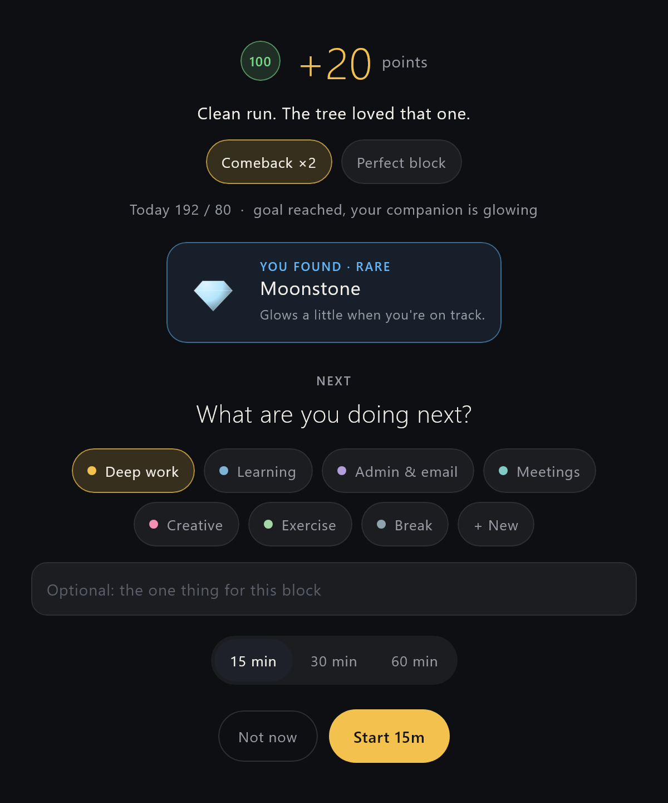

<div align="center">

# Nimisham · നിമിഷം

**A gentle 15-minute focus tracker for Windows and Android, with a companion that grows as you work.**

Every 15 minutes it asks one question: *how did that go?* Tap a rating, pick what's next, and keep going.
No guilt, no lost points, just a little tree (or spirit, or hunter) cheering you on.

[**Download for Windows and Android →**](../../releases/latest)


</div>

---

## Who it's for

- **People with ADHD** or anyone whose focus wanders. You don't need willpower for a whole day, just for the next 15 minutes.
- **Freelancers and students** who want to see where their time actually goes.
- **Anyone who likes a cosy, game-like nudge** more than a strict productivity app.

## How it works

1. **Pick what you're doing**, like Deep work, Learning or Admin, plus an optional "one thing" for this block.
2. **Work.** A calm progress bar floats on top of your screen with the time left and a short quote.
3. **Check in** when the block ends. How focused were you? ✕ drifted · 50 · 75 · 90 · 100.
4. **See what you earned**, and maybe find an artifact. Then choose the next block: 15, 30 or 60 minutes.

<p align="center">
  
  &nbsp;
  
</p>

## Points that never punish you

Nimisham is built on one rule: **a rough block never costs you anything.**

- **Drifted?** You still get **+1** for noticing it honestly, and your next good block counts **double** (a *comeback*).
- **Momentum:** good blocks back to back earn ×1.2, then ×1.5. A drift only pauses it.
- **Surprises:** random *golden blocks* (×3) and *warming eggs* that hatch if you finish at 75%+.
- **Collect artifacts:** 28 to find, from a River Pebble to a Golden Jackfruit. Dry spells raise the odds.
- **Breaks count too:** they earn points, because rest is part of the work.
- **Levels and XP only go up**, and every day starts with a fresh companion.

## Your companion

Pick one in the **Garden**. It sleeps when you're not tracking, grows with your day, and reacts when you click it: a hop, a full 3D spin, or hearts. Each one has its own little sounds, which you can turn off in Settings.

<p align="center"></p>

| | |
|---|---|
| **Maram** 🌳 | A tree on a floating island that grows, blossoms and fruits on perfect blocks |
| **Pulli** ☁️ | A cloud spirit that glows brighter as your day fills up |
| **Hunter** ⚡ | Bulks up as you level, with an aura that changes colour from rank E to S |

## On your computer

A thin bar stays on top of every window. **Drag it anywhere. Double-click it** to switch to *pet mode*, where a bigger companion stands on its own with a tiny timer. Click the companion to play.

<p align="center">
  
  &nbsp;
  
</p>

- Sits in the tray, with a ring that fills as the block runs
- Asks what's first when you turn on the computer, and starts with Windows

## On your phone


- **A permanent notification** with a live countdown. Rate your block straight from it (100% · 75% · Drifted) and keep going.
- **A check-in pops up** when a block ends, even when the phone is asleep.
- **Optional floating bar** over other apps: a thin line at the top, or a small pill you can drag.
- **A home-screen widget** with your companion.
- **Focus view:** a calm full-screen timer that keeps the screen on.
- Starts again by itself after a reboot.

<br clear="right"/>

## Insights

See the whole picture without the judgement: focused time, average focus, comebacks, your best hours and days, where your time went, and a year-long calendar.

<p align="center"></p>

<details>
<summary><b>Garden: your forest and collection</b></summary>
<p align="center"></p>
</details>

---

## Get started

### 1. Install

Go to [**Releases**](../../releases/latest) and download:

- **Windows:** `Nimisham-windows.zip`. Unzip it anywhere (for example `C:\Users\you\AppData\Local\Programs\Nimisham`) and run `Nimisham.exe`.
- **Android:** `Nimisham.apk`. Open it on your phone and allow installing from your browser or files app.

On the phone, open **Settings → On this phone** and tap **Allow background running**, so the timer is never stopped to save battery. On Xiaomi, Oppo, Vivo, Realme or Samsung, also turn on *Autostart* and *No restrictions* in the phone's app settings.

That's it. Everything works on one device straight away.

### 2. Sync your phone and computer (optional, about 5 minutes)

To have the same timer on both, so that stopping on one stops on the other, connect a free [Supabase](https://supabase.com) database. It's yours, and nobody else can see your data.

1. Create a free project at [supabase.com](https://supabase.com).
2. Open **SQL Editor → New query**, paste [`supabase/schema.sql`](supabase/schema.sql), and click **Run**.
3. Open **Authentication → Users → Add user**, enter your email and a password, and tick *Auto Confirm User*.
4. Open **Project Settings → API Keys** and copy the **Project URL** and the **publishable key**.
5. In Nimisham, go to **Settings → Sync**, paste the URL and key, and sign in with your email and password. Do the same on your other device.

Changes show up on the other device within a few seconds.

---

## Use this project

Nimisham is open source (MIT). Use it as it is, change it to fit you, or borrow ideas for your own app.

**Build it yourself.** You need JDK 17+ and the Android SDK (put `sdk.dir=...` in `local.properties`).

```bash
./gradlew :composeApp:run              # run the desktop app
./gradlew :composeApp:assembleDebug    # build the Android APK
./gradlew :composeApp:desktopTest      # tests + screenshots
```

**Skip typing the sync keys.** Add `supabase.url=...` and `supabase.key=...` to `local.properties`, and they're built into your own copy. Then each device only needs your email and password. Never commit that file.

**Make it yours.** Everything is plain Kotlin (Compose Multiplatform: one codebase for both platforms):

- `Scoring.kt`: points, bonuses, artifacts and the quotes on the bar
- `Pets.kt`: the companions, drawn in code, so it's easy to add your own
- `Sound.kt`: the sound effects, also made in code
- `Model.kt`: default categories and colours

Ideas, bug reports and pull requests are welcome.

## Privacy

There are no ads, no tracking and no account with us. Your log stays on your devices, plus your own Supabase project if you turn on sync.

## License

MIT. See [LICENSE](LICENSE).
