<div align="center">

# fifteen.

**A gentle 15-minute focus tracker for Windows and Android, with a companion that grows as you work.**

Every 15 minutes it asks one question: *how did that go?* Tap a rating, pick what's next, and keep going.
No guilt, no lost points, just a little companion (Tree, Clouda or Hunter) cheering you on.

[**Download for Windows and Android →**](../../releases/latest) &nbsp;·&nbsp; [**Support this project 💛**](https://t.me/the_jkj?text=I%20want%20to%20support%20this%20project)

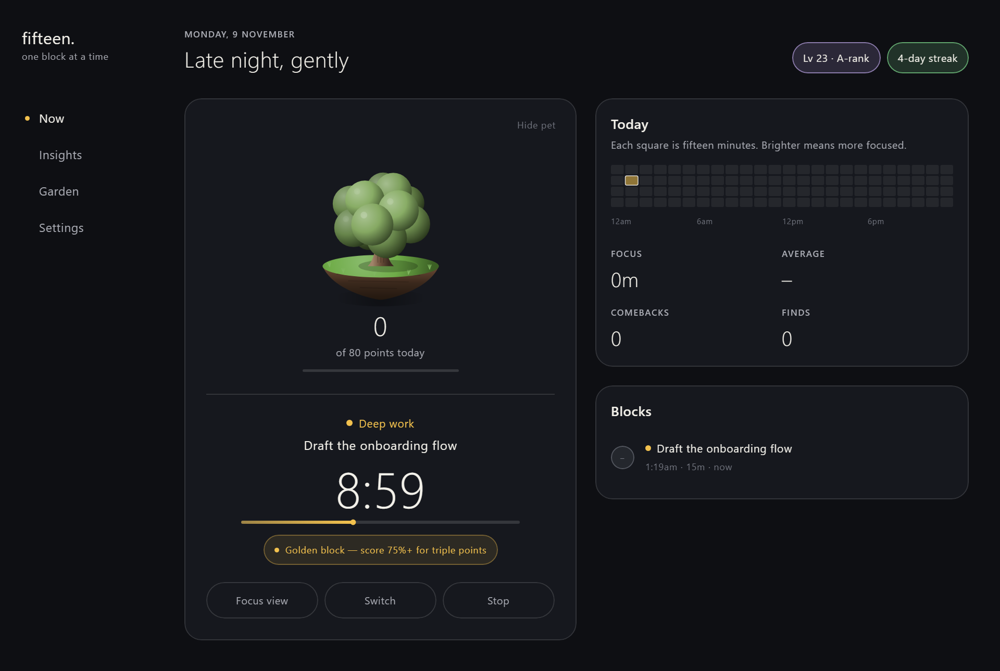

</div>

---

## Who it's for

- **People with ADHD** or anyone whose focus wanders. You don't need willpower for a whole day, just for the next 15 minutes.
- **Freelancers and students** who want to see where their time actually goes.
- **Anyone who likes a cosy, game-like nudge** more than a strict productivity app.

## How it works

1. **Pick what you're doing**, like Deep work, Learning or Admin, plus an optional "one thing" for this block.
2. **Work.** Your companion floats on top of your screen with the time left. Double-click it for a wider bar with a short quote.
3. **Check in** when the block ends. How focused were you? ✕ drifted · 50 · 75 · 90 · 100.
4. **See what you earned**, and maybe find an artifact. Then choose the next block: 15, 30 or 60 minutes.

<p align="center">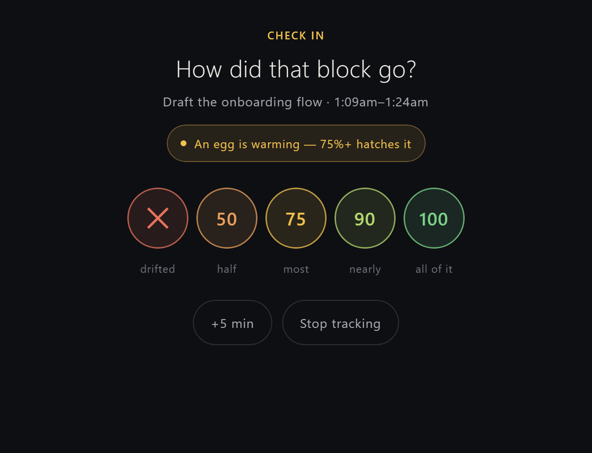</p>

## Points that never punish you

Fifteen is built on one rule: **a rough block never costs you anything.**

- **Drifted?** You still get **+1** for noticing it honestly, and your next good block counts **double** (a *comeback*).
- **Momentum:** good blocks back to back earn ×1.2, then ×1.5. A drift only pauses it.
- **Surprises:** random *golden blocks* (×3) and *warming eggs* that hatch if you finish at 75%+.
- **Collect artifacts:** 28 to find, from a River Pebble to a Golden Jackfruit. Dry spells raise the odds.
- **Breaks count too:** they earn points, because rest is part of the work.
- **Levels and XP only go up**, and every day starts with a fresh companion.

## Your companion

Pick one in the **Garden**. It floats on your screen, grows with your day, naps while you rest, and reacts when you click it: a hop, a full 3D spin, or hearts. Each one has its own little sounds, which you can turn off in Settings.

<p align="center">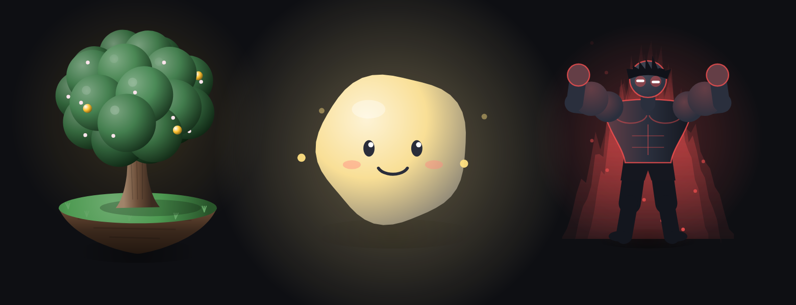</p>

| | |
|---|---|
| **Tree** 🌳 | A small tree on a floating island that grows through the day, blossoms and fruits on perfect blocks |
| **Clouda** ☁️ | A cloud spirit that glows brighter as your day fills up |
| **Hunter** ⚡ | Bulks up as you level, with an aura that changes colour from rank E to S |

## On your computer

Your companion floats on top of every window with a tiny timer. **Drag it anywhere.** Click it to play, **double-click** for the wider bar that shows what you're on, and **right-click** to hide it or quit.

<p align="center">
  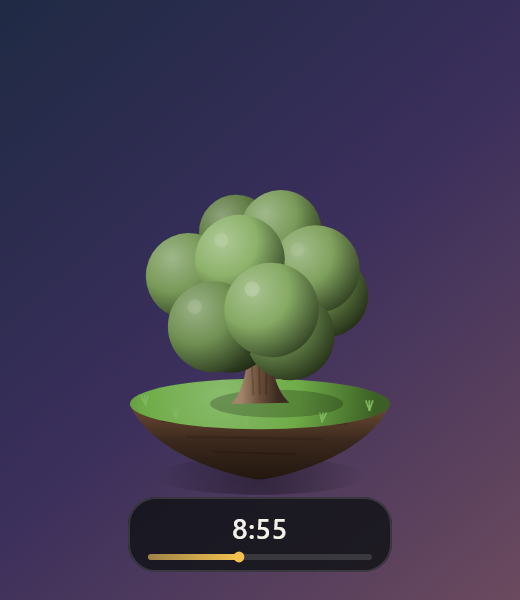
  &nbsp;
  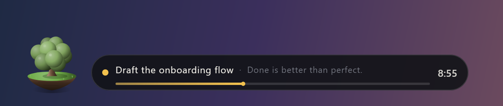
</p>

- **Hide** tucks the pet away; it comes back by itself when the block ends or the next one starts
- Sits in the tray, with a ring that fills as the block runs
- Asks what's first when you turn on the computer, and starts with Windows

## On your phone

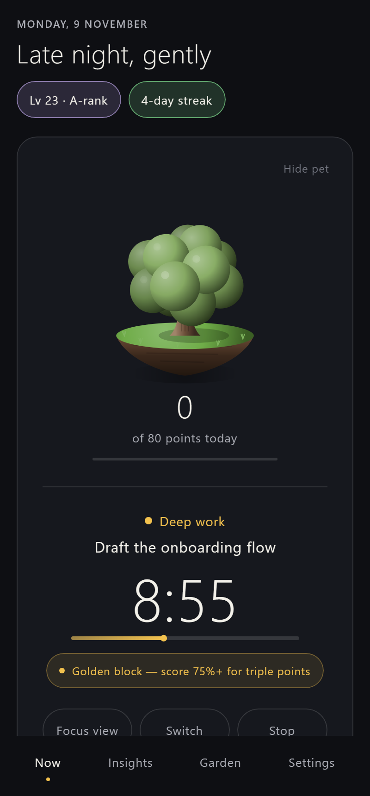

- **A floating pet** over your other apps, in a ring that fills as the block runs. Tap it to play, double-tap to open Fifteen, long-press to hide it or quit, or drag it onto the × to hide it. Prefer something quieter? Pick a thin line or a small pill instead.
- **A permanent notification** with a live countdown. Rate your block straight from it (100% · 75% · Drifted), or tap **Quit** while resting.
- **A check-in pops up** when a block ends, even when the phone is asleep.
- **A home-screen widget** with your companion.
- **Focus view:** a calm full-screen timer that keeps the screen on.
- Starts again by itself after a reboot.

<br clear="right"/>

## Insights

See the whole picture without the judgement: focused time, average focus, comebacks, your best hours and days, where your time went, and a year-long calendar.

<p align="center">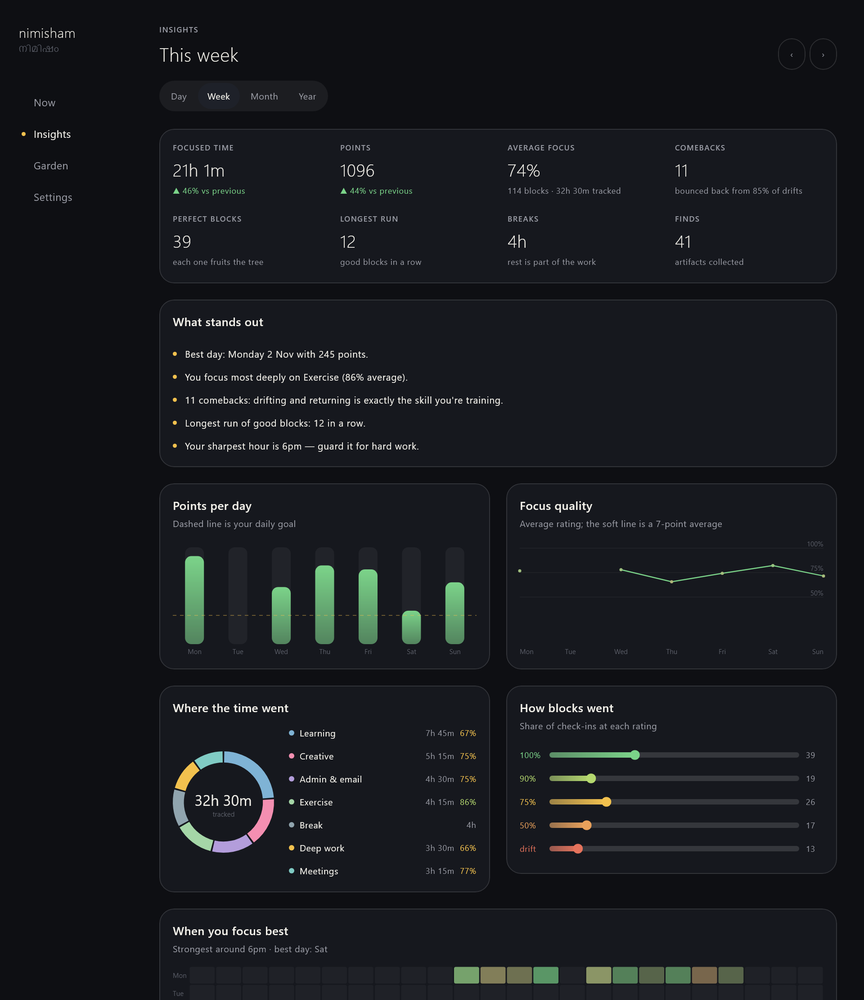</p>

## Garden: your forest and collection

Each day adds a companion to your forest, grown by that day's points. Every artifact you find lands in your collection.

<p align="center">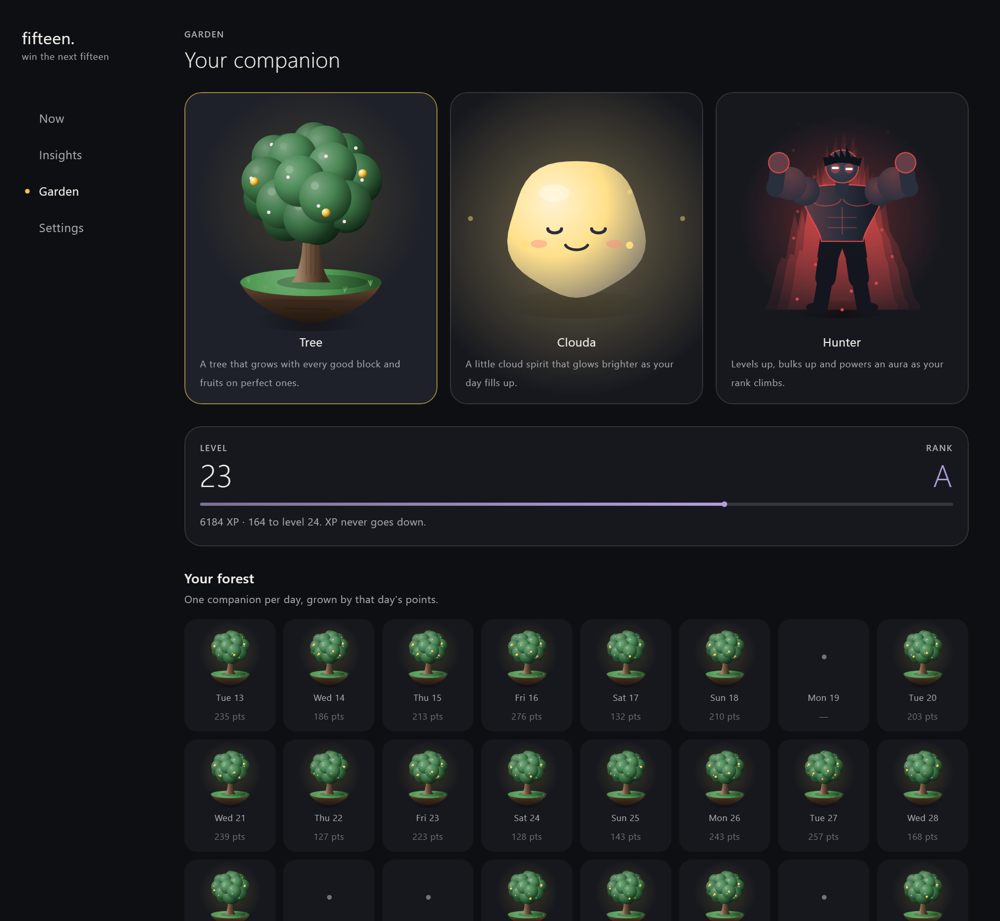</p>

## Add-ons

Little helpers your companion brings up in a chat bubble that comes right out of the floating pet. Turn them on in **Settings → Add-ons**; a small **+** tab appears where you pick which ones.

- **Eye breaks (20-20-20):** every 20 minutes, look about 6 metres away for 20 seconds, with a small timer.
- **Water:** a reminder, then a friendly "did you drink?" later. It tells you how much is a good amount and offers to remind you again.
- **Check-ins:** "Everything okay? Feeling productive?" If not, a small idea to reset, like a stretch, a walk or some water.
- **While you rest:** after a while, your sleeping companion wakes up, asks if everything's okay and offers to start a block. Twice at most, then it lets you be.

They come **anytime** your pet is out, or **only during blocks** if you prefer. Hide the pet and they stay quiet.

<p align="center">
  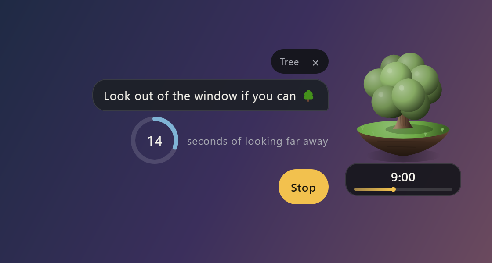
  &nbsp;
  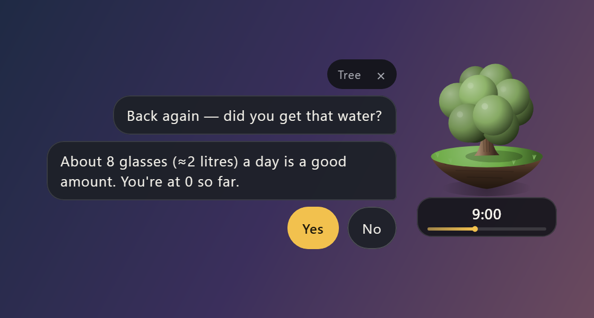
</p>
<p align="center">
  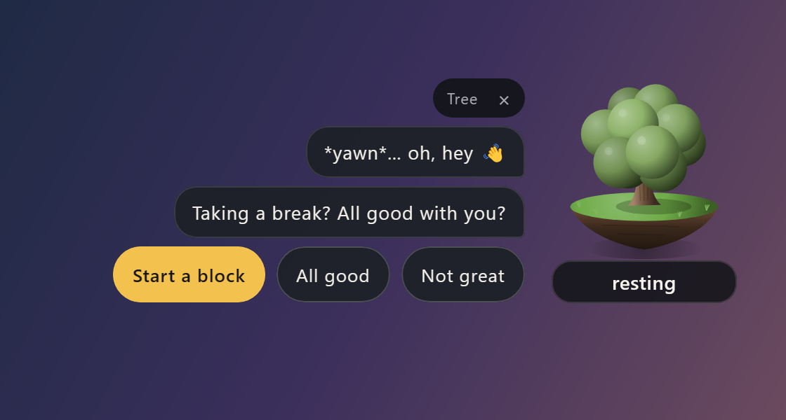
</p>

**Have an idea for an add-on?** See [Contributing](#contributing).

---

## Get started

### 1. Install

Go to [**Releases**](../../releases/latest) and download:

- **Windows:** `Fifteen-windows.zip`. Unzip it anywhere (for example `C:\Users\you\AppData\Local\Programs\Fifteen`) and run `Fifteen.exe`.
- **Android:** `Fifteen.apk`. Open it on your phone and allow installing from your browser or files app.

On the phone, allow **display over other apps** when asked, so your pet can float. If the timer or pet ever stops by itself, open the **Keep it running** box at the bottom of Settings and tap **Allow background running**. On Xiaomi, Oppo, Vivo, Realme or Samsung, also turn on *Autostart* and *No restrictions* in the phone's app settings.

That's it. Everything works on one device straight away.

**Coming from Nimisham?** Fifteen is the same app with a new name. On Windows, your data moves over by itself the first time Fifteen starts; delete the old Nimisham folder afterwards. On Android, Fifteen installs as a new app next to Nimisham. If you use sync, sign in in Fifteen and everything comes back; then uninstall Nimisham. Without sync, your phone history stays in the old app.

### 2. Sync your phone and computer (optional, about 5 minutes)

To have the same timer on both, so that stopping on one stops on the other, connect a free [Supabase](https://supabase.com) database. It's yours, and nobody else can see your data.

1. Create a free project at [supabase.com](https://supabase.com).
2. Open **SQL Editor → New query**, paste [`supabase/schema.sql`](supabase/schema.sql), and click **Run**.
3. Open **Authentication → Users → Add user**, enter your email and a password, and tick *Auto Confirm User*.
4. Open **Project Settings → API Keys** and copy the **Project URL** and the **publishable key**.
5. In Fifteen, go to **Settings → Sync**, paste the URL and key, and sign in with your email and password. Do the same on your other device.

Changes show up on the other device within a few seconds.

---

## Use this project

Fifteen is free for **personal, non-commercial use**. You can read the code and build it for yourself; changes are welcome as pull requests to this repository. See the [license](#license).

**Build it yourself.** You need JDK 17+ and the Android SDK (put `sdk.dir=...` in `local.properties`).

```bash
./gradlew :composeApp:run              # run the desktop app
./gradlew :composeApp:assembleDebug    # build the Android APK
./gradlew :composeApp:desktopTest      # tests + screenshots
```

**Skip typing the sync keys.** Add `supabase.url=...` and `supabase.key=...` to `local.properties`, and they're built into your own copy. Then each device only needs your email and password. Never commit that file.

**Find your way around.** Everything is plain Kotlin (Compose Multiplatform: one codebase for both platforms):

- `Scoring.kt`: points, bonuses, artifacts and the quotes on the bar
- `Pets.kt`: the companions, drawn in code, so it's easy to add your own
- `Sound.kt`: the sound effects, also made in code
- `Model.kt`: default categories and colours

## Contributing

Ideas, bug reports and pull requests are all welcome. **Add-ons are a great first contribution:** posture reminders, stretch breaks, a "stand up" nudge, breathing exercises, or anything that helps people focus kindly. See [CONTRIBUTING.md](CONTRIBUTING.md) for how to get started.

## Support

Fifteen is free and made by one person. If it helps you, [**send a message on Telegram**](https://t.me/the_jkj?text=I%20want%20to%20support%20this%20project) to support the project. 💛

## Privacy

There are no ads, no tracking and no account with us. Your log stays on your devices, plus your own Supabase project if you turn on sync.

## License

**Personal use only.** You can use Fifteen and read its code for yourself, but not for anything commercial, and you can't share modified versions or reuse its code elsewhere. Changes are welcome as pull requests to this repository. See [LICENSE](LICENSE) for the exact terms, and ask on [Telegram](https://t.me/the_jkj) if you'd like other permission.
